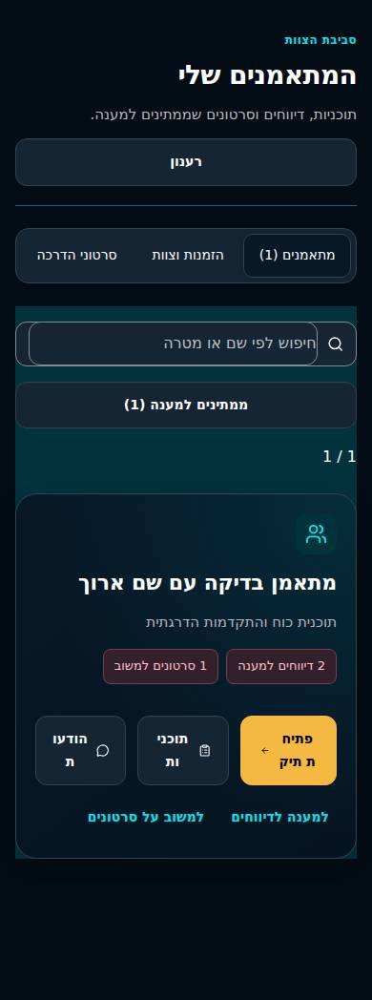
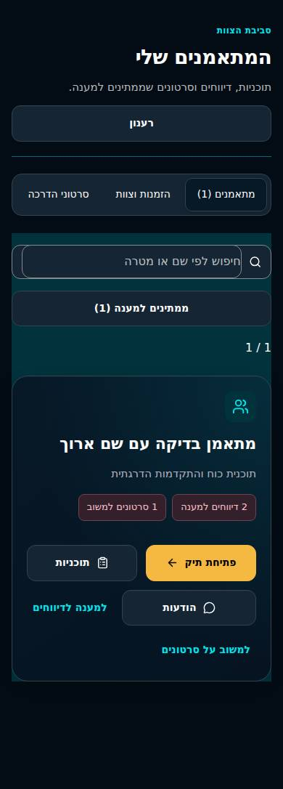

# DoctorCoach — team and program layout repair, 4 November 2026

## Scope and repository state

Continues PR #65 at `8e1f40976e1928e45a7d5877db47de0350fd6650` on the dedicated branch `fix/dashboard-rtl-20261104`. PR #65 and PR #66 were both open, ready for review and unmerged at task start. This correction is a child of #65; it does not combine, merge or deploy either PR.

The reported Hebrew wrapping problem was reproduced in Chromium 153 using actual `TeamWorkspace`, `CareWorkspace`, `ProgramBuilder` and the complete application stylesheet stack. The shell and API records are synthetic local fixtures; these screenshots are not live LAB or real-account acceptance.

## Confirmed defects and root causes

| Surface | Reproduction | Root cause | Correction |
|---|---|---|---|
| Team roster, 320/390 px | פתיחת, תוכניות and הודעות split inside words | Action buttons flex-shrink below label width; Premium's shared `overflow-wrap:anywhere` permits arbitrary breaks | Actions wrap as whole buttons with a 140px basis; preserve normal word boundaries and icon width |
| Program editor, 768 px | RIR label ברזרבה splits; fields measured 90px | Viewport breakpoint assumes two fields fit, although sidebar and nested editor consume available space | Intrinsic grid with 160px field basis and a 100% cap |
| Trainee heading, 768 px | רענון splits | Long heading competes with a shrinking action button | Headings may wrap; direct action buttons retain their width |
| Client file areas, English, 768 px | Rehabilitation splits in a 114px tab | Fixed four-column navigation ignores translated label width | Intrinsic columns with a 130px basis, capped at four per row; normal word boundaries |

Changes are limited to layout rules in `app/premium-ui-3.css`, a browser regression harness and CI wiring. Colors, typography tokens, existing components, workout/RPE calculations, server permissions and persistence are unchanged. There is no SQL, API, dependency or lockfile change.

## Before and after

Actual synthetic team component, Hebrew/dark, 390px. JPEG encoding is used only for compact review evidence.

| Before | After |
|---|---|
|  |  |

## Regression verification

`scripts/dashboard-layout-browser-smoke.mjs` mounts real components with real styles and intercepts all API calls locally. No external service requests or real records are used. Draft autosaves are simulated in memory.

The default matrix covers 3 surfaces × 7 widths × 2 languages × 2 themes = **84 cases**. Widths: **320, 375, 390, 430, 768, 1024, 1440px**. Surfaces: roster, client program editor with actual populated fields, and trainee assigned programs with the details/disclosure explicitly opened. The test asserts expected visible content and actual RTL/LTR direction before measurement.

DOM word ranges detect words wrapping across lines; additional assertions detect clipping, document overflow, browser exceptions and unexpected API contracts. Closed details and hidden text are excluded from geometry checks. Tab decoration pseudo-elements are not mistaken for clipped text; actual text rectangles are checked against button bounds. CI requires all 84 cases and forbids record-only mode.

The test failed on the reported words before correction, then passed the complete matrix after the fixes. Source results: `dashboard-rtl-20261104/results.json`. CI retains the complete screenshot matrix as `dashboard-layout-evidence` for seven days.

| Check | Result |
|---|---|
| Unmodified #65 baseline | 1,755 standalone tests passed |
| Corrected standalone suite | 1,755 passed, 0 failed/skipped |
| Final dedicated browser matrix | 84 passed, no broken words/clipping/overflow/page errors |
| TypeScript | Passed |
| Isolated Worker build | Passed; existing build warnings |
| Static isolated target | Passed |
| Built Worker synthetic HTTP suite | Passed, including auth/roles/private files/training/import/Calendar |
| Existing Premium UI quick regressions | 26 captures per theme, 52 total; 8 persisted workout flows across HE/EN and 390/1440px; no page errors |
| Changed script lint | Passed, zero errors/warnings |
| Full lint | Not rerun for this CSS/test correction; previously documented project lint debt remains |

The existing Premium UI 3 quick smoke also exercises the full application fixture in Hebrew/English and dark/light modes, including persisted synthetic workout save/edit/reload/completion/history/next-load flows. Its logs and screenshots are local QA evidence; final exact-head GitHub checks are reported on the PR separately.

## CI and release boundaries

The workflow now accepts child PRs targeting `feature/premium-workout-4-*`. The new layout matrix runs for this correction, Workout 4 child PRs and integration audit branches. Existing checks were not removed or disabled. The separate, existing branch conditions for other feature-only suites remain in place.

Independent review found gaps in the initial fixture coverage, which were corrected before final verification. No important issue remained in the subsequent review of the repair.

No remote migration, record/grant/secret change, external Calendar event, deployment or PR merge was performed. Live Calendar/UID activation, current protected backup/restore and physical-device/real-account acceptance gates from PR #66 remain. This is a reviewed development candidate, not a claim that the live LAB already contains the repair.

Reproduce from `apps/doctorcoach-standalone`:

```bash
DC_CHROMIUM=/path/to/chrome CI=true node --experimental-strip-types scripts/dashboard-layout-browser-smoke.mjs
npm test
npm run typecheck
DC_ISOLATED_STAGING_BUILD=true npm run build:standalone
node standalone/scripts/check-isolated-staging.mjs dist/server/wrangler.json
node --experimental-strip-types standalone/scripts/runtime-smoke.mjs
```
